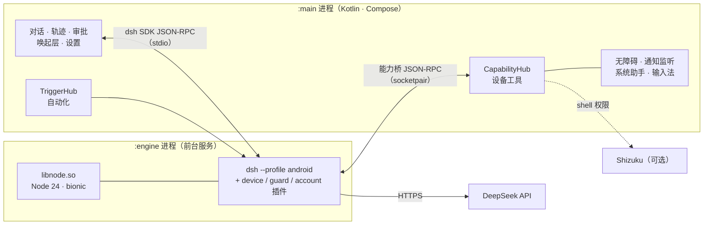

<div align="center">

# DSH-Android

### 一句话，让手机替你办事。

在安卓手机上运行 [DeepSeek Harness](https://github.com/deepseek-ai/deepseek-harness)（dsh）：用一句话让它整理文件、操作 App、修改系统设置，或者设置自动执行的任务。


**[下载 APK](../../releases/latest)** • **[快速开始](#快速开始)** • **[架构](#架构)** • **[从源码构建](#开发者)**

</div>

---

## 快速开始

1. 从 [Releases](../../releases/latest) 下载 APK 并安装（arm64，Android 10 及以上）。
2. 登录 DeepSeek 账号，或者填入 [API key](https://platform.deepseek.com/api_keys)；也可以在 设置 → 模型服务 里添加其他服务商。
3. 直接说要做什么，比如“列出下载目录里最大的 5 个文件”。用到某项权限时，App 会再引导你开启。
4. 可选：在 设置 → 手机权限 里一键安装 Shizuku，并在 Shizuku 里打开“开机启动（无线调试）”。

## 界面一览

<table>
  <tr>
    <td align="center" width="33%"><br /><sub><b>首页</b>：直接说你要做什么</sub></td>
    <td align="center" width="33%"><br /><sub><b>操作手机</b>：开关 Wi‑Fi、蓝牙、勿扰等</sub></td>
    <td align="center" width="33%"><br /><sub><b>轨迹</b>：按轮次回看 agent 做了什么</sub></td>
  </tr>
  <tr>
    <td align="center"><br /><sub><b>随处唤起</b>：悬浮球、系统助手、快捷磁贴、分享</sub></td>
    <td align="center"><br /><sub><b>手机权限</b>：用到才申请，一处管理</sub></td>
    <td align="center"><br /><sub><b>会话列表</b></sub></td>
  </tr>
</table>

## 能做什么

- **文件**：查找、整理、移动、重命名、压缩解压；能读 PDF / Word / Excel / PPT 里的文字。
- **屏幕和 App**：读屏、点击、滑动、输入（基于无障碍服务）；打开 App 或直接跳到指定页面。
- **连续手机操作**：`phone_run` 在一次调用内按顺序执行原生 App 操作，`phone_collect` 滚动收集多屏内容；动作后自适应等待，OCR 点击前校验画面。遇到目标不明确或页面变化时停止并返回已有进度。见 [原生手机自动化](docs/PHONE-AUTOMATION.md)。
- **系统设置**：亮度、音量、勿扰、闹钟、Wi‑Fi、蓝牙、定位；读取和回复通知，控制媒体播放。
- **自动化**：定时执行，或在连上 Wi‑Fi/蓝牙、开始充电、到达某地、收到通知等条件下触发。
- **其他模型服务**：除 DeepSeek 外，可添加 OpenAI、Claude、Gemini、Grok、OpenRouter、Kimi、智谱 GLM、通义千问、火山方舟、MiniMax、硅基流动、阶跃星辰，或任意 OpenAI 兼容接口；填 key、拉取模型列表即可在模型选择器里切换。
- **完整的 dsh**：dsh 原样运行（没有 fork），技能、MCP、子 agent、网页搜索都能用。
- **不需要 root 或 Termux**：装一个 APK 就能用；Shizuku 可选，能解锁更多系统开关。

## 架构



- **引擎嵌在 App 进程里**：Node 24 编译成安卓原生的共享库，通过 JNI 在 `:engine` 前台服务中启动。不用 proot、不用 Termux，也不会碰到安卓 12 以后的“幽灵进程”限制。
- **dsh 不做 fork**：App 只通过 dsh 的 SDK 协议和它对话；安卓相关的适配都放在插件和少量补丁里。
- **手机能力在 App 侧**：所有设备工具都由 Kotlin 实现，通过一条私有的 socket 通道暴露给 dsh（见 [引擎契约](docs/ENGINE-CONTRACT.md)）。

## 系统要求

Android 10 及以上，arm64-v8a；安装包约 110 MB，建议预留 500 MB 可用空间；需要能访问 DeepSeek API。

## 安装时提示“已屏蔽有害应用”

DSH-Android 不在 Google Play 上分发，又用到了无障碍、通知读取、短信等能力，Google Play 保护机制可能把它误判为有害应用。核对过下载的 APK 和发布说明里的 SHA-256 一致后，可以这样安装：

- **在手机上安装**：弹窗里点“更多详情”，再点“仍要安装”。不要点“知道了”，那会取消安装。
- **用 `adb install`**：命令会一直没有输出，因为手机上在等你处理上面这个弹窗，看一眼手机屏幕就行。也可以先执行 `adb shell settings put global verifier_verify_adb_installs 0` 跳过对 adb 安装的检查，装完再改回 `1`。

## 当前限制

- **锁屏后不能操作其他 App**：在有安全锁屏的情况下，系统不允许操作其他 App 的界面。这类任务会暂停，提示你解锁后继续。系统 API 类的任务（文件、设置、通知等）锁屏时照常执行。
- **Shizuku 重启后要重新启动**：建议打开 Shizuku 的“开机启动（无线调试）”（需要 Shizuku 13.6 及以上、Android 11 及以上）。
- **国产 ROM**：部分机型需要手动允许“后台弹出界面”和“自启动”，悬浮球和后台自动化才能稳定工作。App 的体检页会提示你。
- **第三方模型**：只支持 OpenAI 兼容的 Chat Completions 接口（HTTPS）；上下文统一按 128K 计，不提供推理等级选择；联网搜索由 DeepSeek 提供，使用第三方模型时需要另外配置 DeepSeek API key。工具调用的效果取决于所选模型。
- **冷启动**：引擎冷启动目前大约 5 秒，还在优化。

## 开发者

<details>
<summary><b>从源码构建</b></summary>

需要 JDK 21、Android SDK（compileSdk 37.2）、NDK r29。在 arm64 Linux 主机上构建时，需要额外传入 `-Pandroid.aapt2FromMavenOverride=<arm64 版 aapt2 的路径>`。

```bash
# 1. 原生库（libnode 等）：下载预编译产物并校验哈希，不用自己编 Node
native/prebuilt.sh fetch            # → toolchains/out/jniLibs/arm64-v8a/

# 2. 引擎包：dsh + 插件 + 补丁 → engine.zip
OUT_DIR=<engineOut> js/build-engine.sh

# 3. APK
./gradlew :app:assembleDebug -Pdsh.engineOut=<engineOut>
```

- 预编译产物的标签由 Node 版本加上全部原生补丁的哈希生成（比如 `native-node24.22.1-caacecde44`）。只有升级 Node 或改动原生补丁时才需要重编：先运行 `native/build.sh`，再用 `native/prebuilt.sh publish` 发布。
- 主机端到端测试（真实调用 DeepSeek API）：`node js/test/host-e2e.mjs`，API key 放在一个文件里，用环境变量 `DSH_E2E_KEY_FILE` 指定路径（默认是 `~/.config/dsh/deepseek_api_key`）。

</details>

<details>
<summary><b>目录结构</b></summary>

```text
app/        Android App（Kotlin · Compose · Hilt · Room）
  core/engine/       引擎进程、JNI 启动、崩溃恢复
  core/capability/   设备工具（文件、屏幕、系统、通知、媒体……）
  core/trigger/      自动化规则和事件源
  feature/           界面：对话、轨迹、快捷面板、自动化、设置、登录
js/         dsh 的 android profile、插件、补丁，build-engine.sh → engine.zip
native/     Node 24 安卓构建、JNI 包装、原生插件、预编译产物脚本
tools/      字符串、图标等生成脚本
docs/       架构说明、引擎契约、设计 token、截图
```

</details>

<details>
<summary><b>设计文档</b></summary>

- [架构](docs/ARCHITECTURE.md)
- [引擎契约（App ↔ dsh）](docs/ENGINE-CONTRACT.md)
- [设计 token](docs/design-tokens.md)

</details>

## 致谢

- [DeepSeek Harness](https://github.com/deepseek-ai/deepseek-harness)：agent 引擎
- [Node.js](https://nodejs.org)；安卓构建参考了 [Termux](https://github.com/termux/termux-packages) 和 [nodejs-mobile](https://github.com/nodejs-mobile/nodejs-mobile) 的做法
- [Shizuku](https://github.com/RikkaApps/Shizuku)（Apache-2.0）：App 内置了官方安装包
- [ripgrep](https://github.com/BurntSushi/ripgrep)
- [dsh-llm-service-lite](https://github.com/snnh/dsh-llm-service-lite)（MIT，snnh）：第三方模型适配器，原样内置于 `js/packages/llm-service-lite/`
- [magpie](https://github.com/yetone/magpie)（MIT）：服务商预设地址和接入 dsh 的经验（按协议分组、maxTokens 与压缩阈值）

## 声明

本项目是社区项目，与 DeepSeek 官方无关联，也未获其背书。“DeepSeek”及相关商标归其各自所有者所有。

## 许可证

[Apache License 2.0](LICENSE)。内置的第三方组件（Node.js、dsh、dsh-llm-service-lite、Shizuku、ripgrep 等）遵循各自的许可证。
